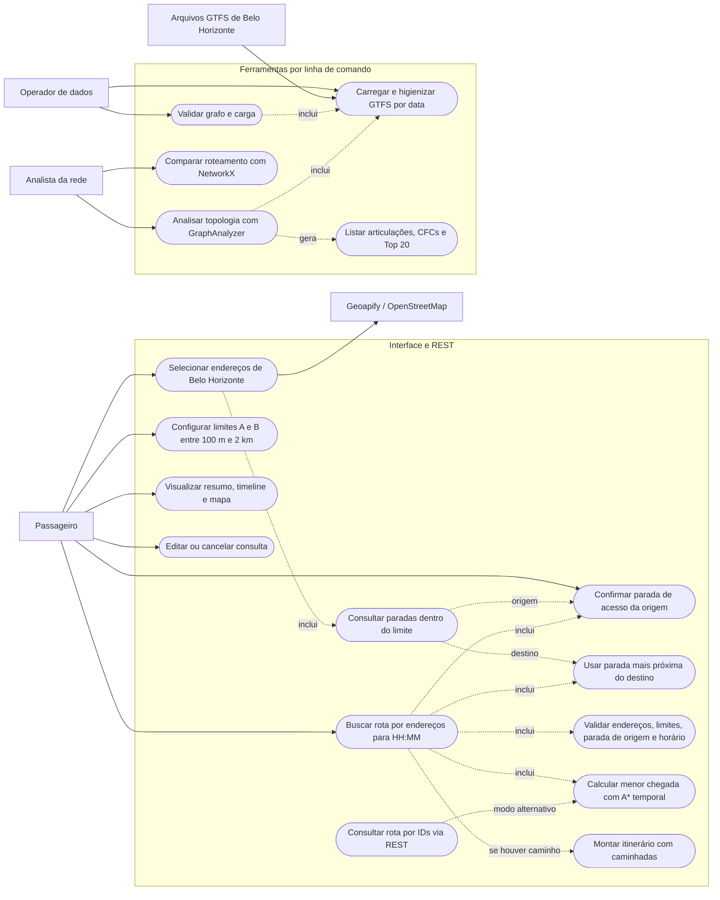

# Diagrama de Casos de Uso - MVP RotasGraph

Capacidades disponíveis, representadas com `flowchart`.

O frontend usa `GET /config/geocoding`, Geoapify/OpenStreetMap e
`POST /snap/candidates`. A origem recomenda a parada mais próxima, mas permite
outra candidata dentro do limite; o destino usa automaticamente a primeira.
Os limites são independentes, aceitam metros inteiros entre 100 e 2.000 e podem
ser salvos antes do endereço.

`POST /routes/search` recebe `mode: "address"`, os dois endereços com
coordenadas e limites, a parada confirmada da origem e `departure_time`. O modo
por `origin_id` e `destination_id` permanece como contrato REST alternativo.
As caminhadas temporárias são removidas ao final da consulta.
A análise usa `python -m app.analyze_topology`, sem endpoint analítico.
Seu ranking mede impacto estrutural, sem inferir demanda. O benchmark existente
não comprova a escalabilidade da campanha ainda pendente.

Consulte [a API](../../docs/API.md), [a CLI](../../docs/GRAPH_ANALYZER.md) e
[o benchmark](../../docs/BENCHMARK.md).

## Referências do padrão

- [OMG - Unified Modeling Language](https://www.omg.org/UML/what-is-uml.htm)
- [Mermaid - Use case diagrams](https://mermaid.js.org/syntax/usecase.html)
- [GitHub - Diagramas Mermaid em Markdown](https://docs.github.com/en/get-started/writing-on-github/working-with-advanced-formatting/creating-diagrams)
