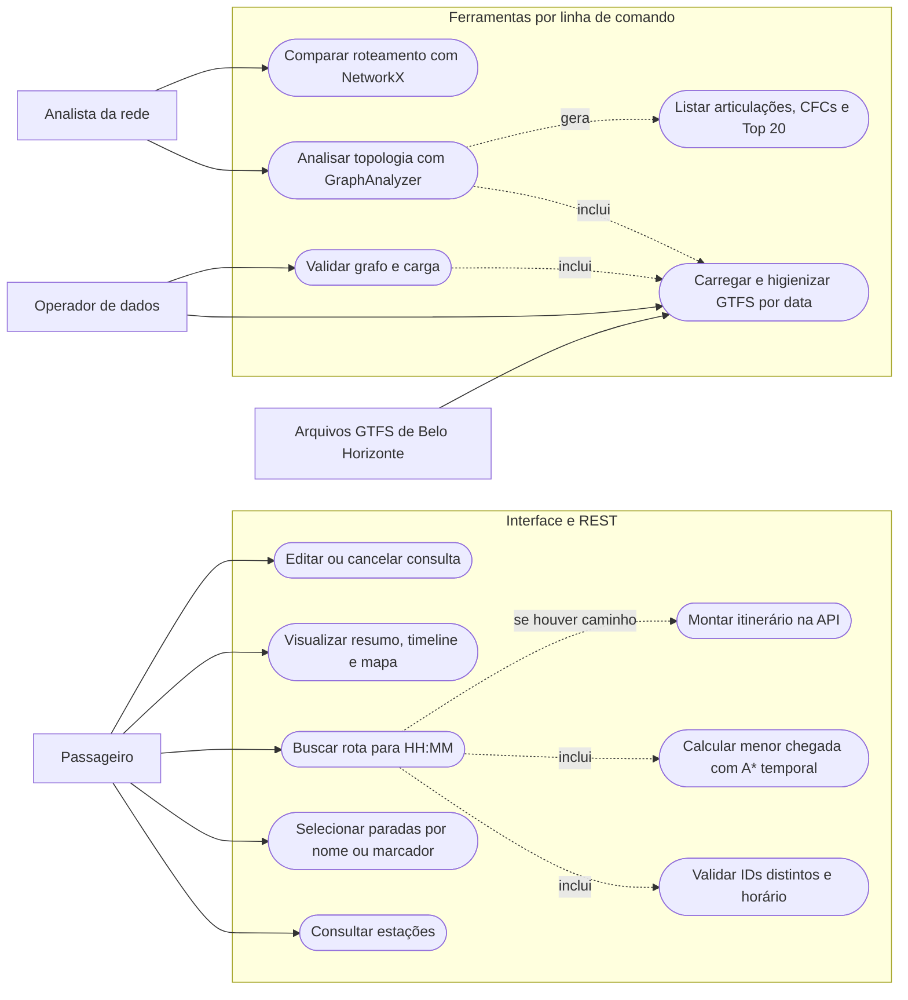

# Diagrama de Casos de Uso - MVP RotasGraph

Capacidades disponíveis, representadas com `flowchart`.

O REST expõe `GET /stations`, `POST /routes/search` e `GET /health`, além dos
recursos estáticos e documentação FastAPI. A busca recebe apenas `origin_id`,
`destination_id` e `departure_time`; marcadores escolhem estações cadastradas.

`snap_to_network` é interno, sem caso de uso público de coordenadas arbitrárias.
A análise usa `python -m app.analyze_topology`, sem endpoint analítico.
Seu ranking mede impacto estrutural, sem inferir demanda. O benchmark existente
não comprova a escalabilidade da campanha ainda pendente.

Consulte [a API](../../docs/API.md), [a CLI](../../docs/GRAPH_ANALYZER.md) e
[o benchmark](../../docs/BENCHMARK.md).

## Referências do padrão

- [OMG - Unified Modeling Language](https://www.omg.org/UML/what-is-uml.htm)
- [Mermaid - Use case diagrams](https://mermaid.js.org/syntax/usecase.html)
- [GitHub - Diagramas Mermaid em Markdown](https://docs.github.com/en/get-started/writing-on-github/working-with-advanced-formatting/creating-diagrams)
