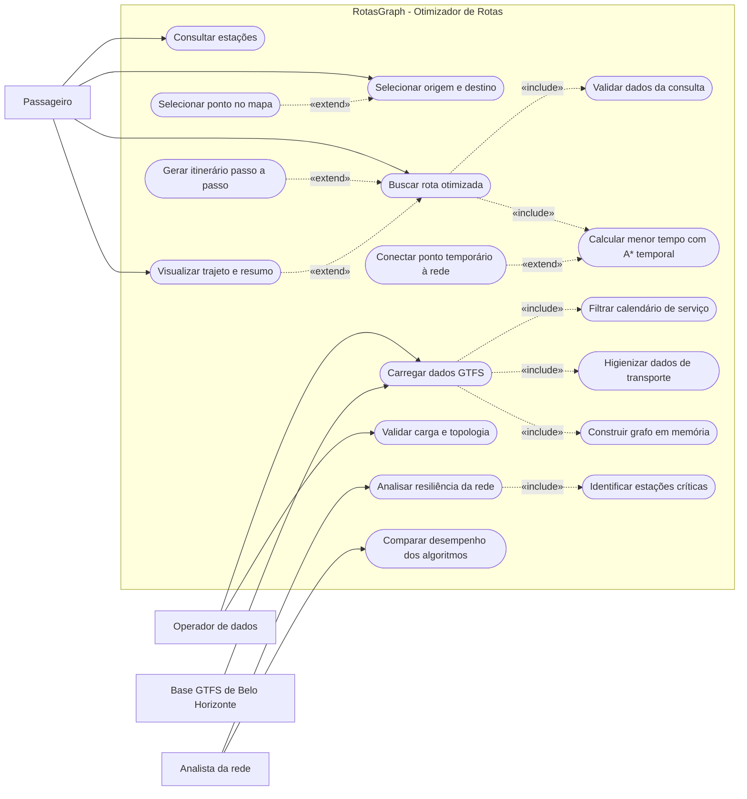

# Diagrama de Casos de Uso - MVP RotasGraph

Este diagrama representa a arquitetura-alvo do MVP completo. Ele inclui
funcionalidades implementadas e planejadas no `docs/PLAN.md`.

O limite do sistema e os casos de uso seguem a notação UML. O código usa
`flowchart`, em vez do `usecase-beta` introduzido no Mermaid 12, para manter a
renderização compatível com visualizadores Mermaid anteriores.

## Atores

| Ator | Responsabilidade |
|---|---|
| Passageiro | Informa o deslocamento e consulta a melhor rota disponível. |
| Operador de dados | Prepara, carrega e valida a base GTFS usada pelo sistema. |
| Analista da rede | Avalia vulnerabilidades e desempenho do modelo de grafos. |
| Base GTFS | Sistema externo que fornece paradas, linhas, viagens e calendários. |

## Referências do padrão

- [OMG - Unified Modeling Language](https://www.omg.org/UML/what-is-uml.htm)
- [Mermaid - Use case diagrams](https://mermaid.js.org/syntax/usecase.html)
- [GitHub - Diagramas Mermaid em Markdown](https://docs.github.com/en/get-started/writing-on-github/working-with-advanced-formatting/creating-diagrams)
