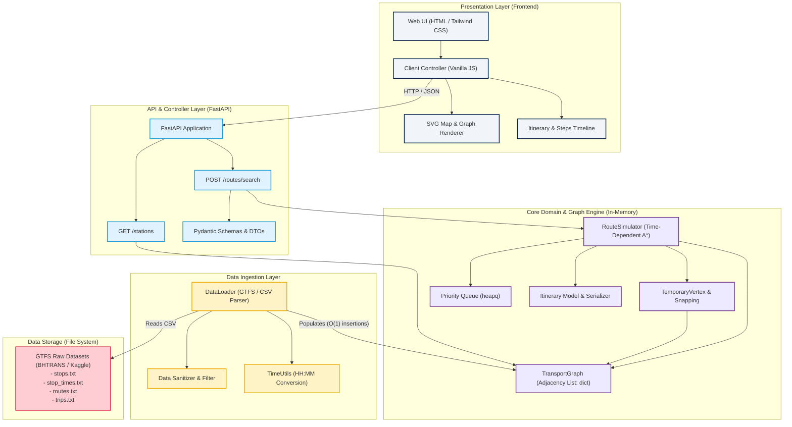

# System Component Architecture Diagram

This document describes the high-level architecture and layered decoupling of the Public Transit Route Optimization system, satisfying academic domain isolation and modularity requirements.

## Architectural Justification & Decoupling

1. **Zero UI Coupling in Graph Core**: The mathematical engine (`TransportGraph`, `RouteSimulator`) has no dependencies on HTTP frameworks, presentation logic, or external graphing libraries like NetworkX.
2. **In-Memory Performance**: `TransportGraph` relies strictly on native Python dictionary-based adjacency lists, ensuring $O(1)$ vertex lookup and neighbor retrieval.
3. **Pluggable Ingestion**: `DataLoader` isolates file format specifics (GTFS CSVs from BHTRANS or any city). Swapping the data source does not require changing the routing engine.
4. **Admissible Heuristics**: `RouteSimulator` implements Time-Dependent A* with Haversine distance normalized by maximum network velocity ($h(u, v) = \text{haversine}(u, v) / V_{\max}$), ensuring optimality and fast pruning.

