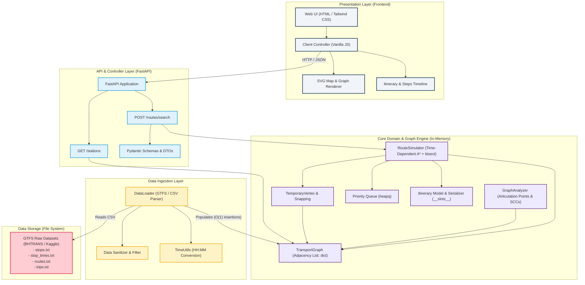

# System Component Architecture Diagram

This document describes the high-level architecture and layered decoupling of the Public Transit Route Optimization system, satisfying academic domain isolation and modularity requirements.

## Architectural Justification & Decoupling

1. **Zero UI Coupling in Graph Core**: The mathematical engine (`TransportGraph`, `RouteSimulator`, `GraphAnalyzer`) has no dependencies on HTTP frameworks, presentation logic, or external graphing libraries like NetworkX.
2. **In-Memory Performance & `__slots__`**: `TransportGraph` relies strictly on native Python dictionary-based adjacency lists, ensuring $O(1)$ vertex lookup and neighbor retrieval, while high-cardinality domain entities (`Station`, `Connection`, `Itinerary`) enforce `__slots__` to eliminate per-instance `__dict__` overhead.
3. **Logarithmic Temporal Lookup**: Connections per station are sorted by departure time, enabling `RouteSimulator` to locate the next available trip in $O(\log K)$ using Python's native `bisect` module.
4. **Network Resilience & Topology Analysis**: `GraphAnalyzer` computes Articulation Points (DFS with `lowpt`) and Strongly Connected Components (Kosaraju/Tarjan) to identify critical transit hubs and structural vulnerabilities for the SBC report.
5. **Pluggable Ingestion**: `DataLoader` isolates file format specifics (GTFS CSVs from BHTRANS or any city). Swapping the data source does not require changing the routing engine.
6. **Admissible Heuristics**: `RouteSimulator` implements Time-Dependent A* with Haversine distance normalized by maximum network velocity ($h(u, v) = \text{haversine}(u, v) / V_{\max}$), ensuring optimality and fast pruning.
