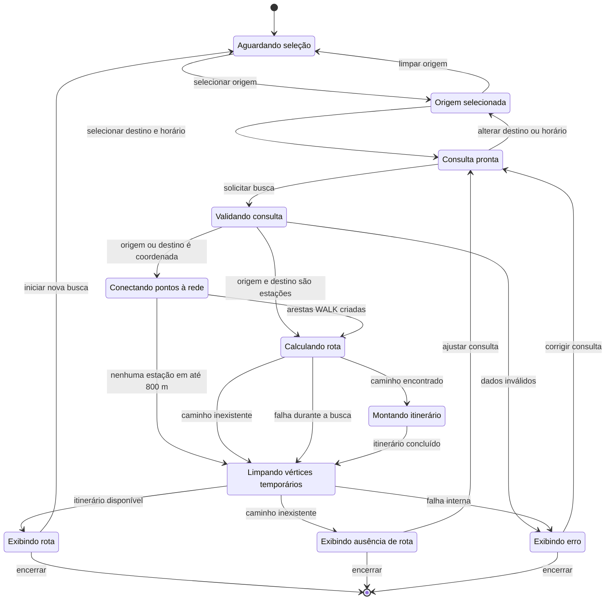

# Diagrama de Estados - Consulta de Rota

Esta máquina de estados representa a arquitetura-alvo da consulta principal do
MVP, desde a seleção dos pontos até a apresentação do itinerário. Os vértices
temporários existem somente durante a busca e são removidos antes da resposta.

## Regras representadas

- Uma busca só começa com origem, destino e horário válidos.
- Cliques arbitrários usam `TemporaryVertex` e conexões `WALK` até a estação
  real mais próxima, limitada a 800 metros.
- A busca temporal considera horários de partida e tempo de espera.
- A limpeza acontece antes de qualquer resposta que suceda à criação de
  vértices temporários, inclusive quando ocorre uma exceção.

## Referência do padrão

- [Mermaid - State diagrams](https://mermaid.js.org/syntax/stateDiagram.html)
