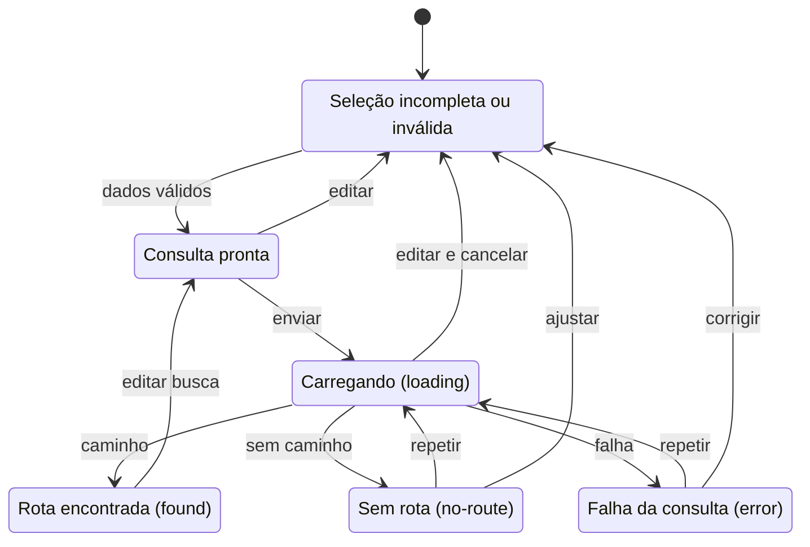

# Diagrama de Estados - Consulta de Rota

Estados observáveis da consulta pública por estações. A seleção pode começar
pela origem ou destino; editar um texto invalida o ID confirmado.

`createRouteRequest` mantém `idle`, `loading`, `found`, `no-route` e `error`.
A seleção é derivada de `validateSelection`. Durante `loading`, o envio fica
bloqueado; editar cancela a requisição e invalida sua versão.

O autocomplete tem estados próprios (`idle`, `loading`, `ready`, `empty`,
`error`) em `createStationRequest`. O mapa seleciona paradas recebidas da API.
`snap_to_network` e sua limpeza são internos, fora deste fluxo público.
O REST usa `origin_id`, `destination_id` e `departure_time`.

[Referência Mermaid](https://mermaid.js.org/syntax/stateDiagram.html).
