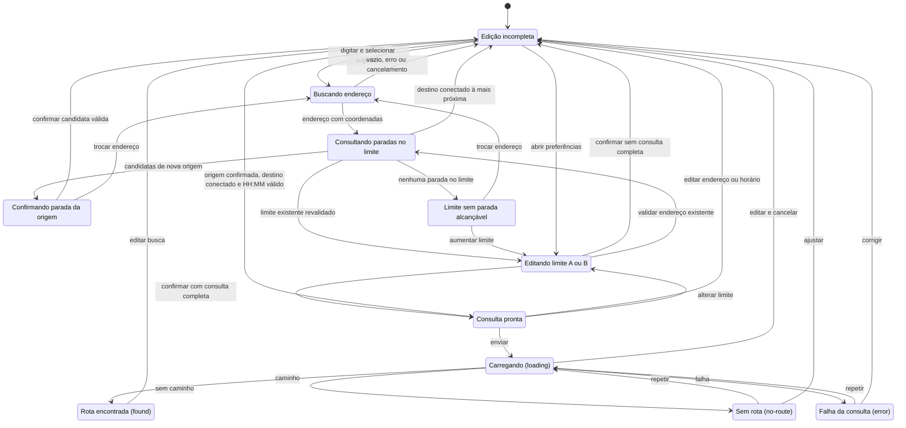

# Diagrama de Estados - Consulta de Rota

Estados observáveis da consulta pública por endereços. Origem e destino têm
limites independentes e podem ser preenchidos em qualquer ordem.

`validateAddressSelection` só libera o envio com endereço e parada confirmada
na origem, endereço e candidata no destino e horário `HH:MM`. O limite varia
por metro entre 100 e 2.000; sem endereço, pode ser salvo sem consultar a API.
Com endereço, a alteração chama `POST /snap/candidates` e bloqueia a confirmação
quando nenhuma parada cabe no raio.

A origem recomenda a candidata mais próxima e permite selecionar outra válida.
O destino escolhe automaticamente a primeira. Durante `loading`, editar cancela
a requisição e descarta respostas antigas. O modo por IDs continua disponível
na API, mas não representa o fluxo principal da interface.

[Referência Mermaid](https://mermaid.js.org/syntax/stateDiagram.html).
