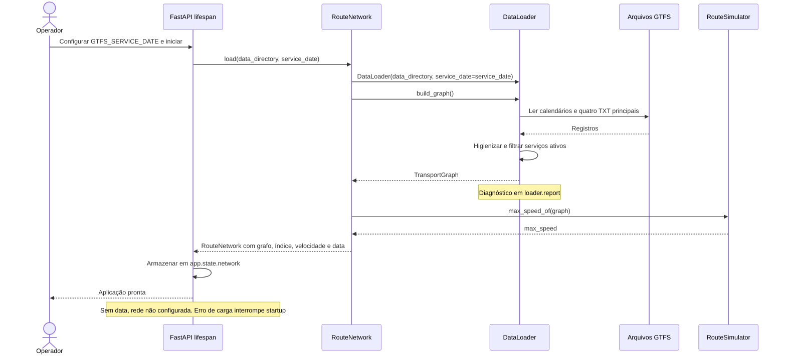
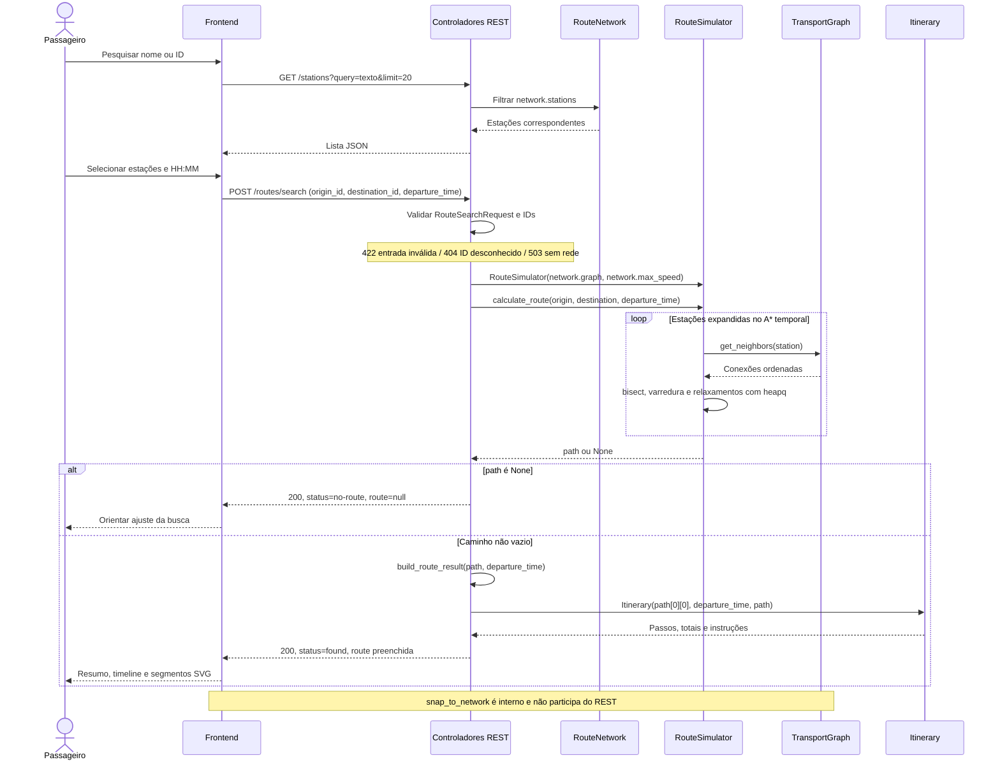

# Diagramas de Sequência - MVP RotasGraph

## 1. Inicialização para uma data de serviço

## 2. Busca por estações

O roteador retorna `list[tuple[Station, Connection]] | None`. No domínio,
origem igual ao destino retorna `[]`; o REST exige IDs distintos. Editar
cancela a requisição no frontend e descarta respostas antigas.

A CLI `app.analyze_topology` chama `DataLoader.build_graph` e `GraphAnalyzer`
e exporta JSON separadamente, sem endpoint analítico. Veja
[a API](../../docs/API.md) e [a CLI](../../docs/GRAPH_ANALYZER.md).

## Referência do padrão

- [Mermaid - Sequence diagrams](https://mermaid.js.org/syntax/sequenceDiagram)
