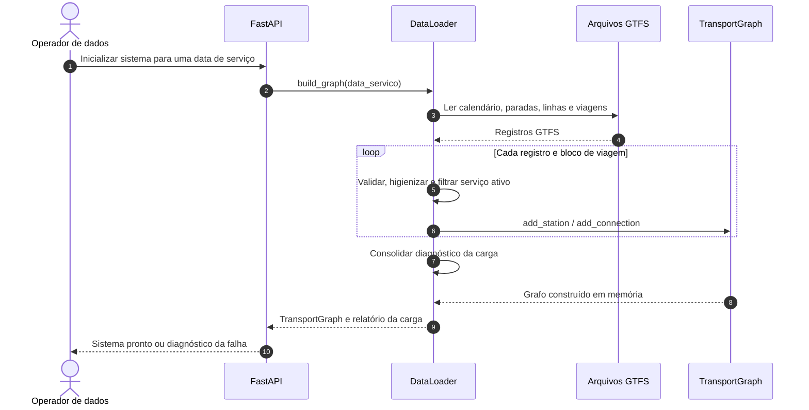
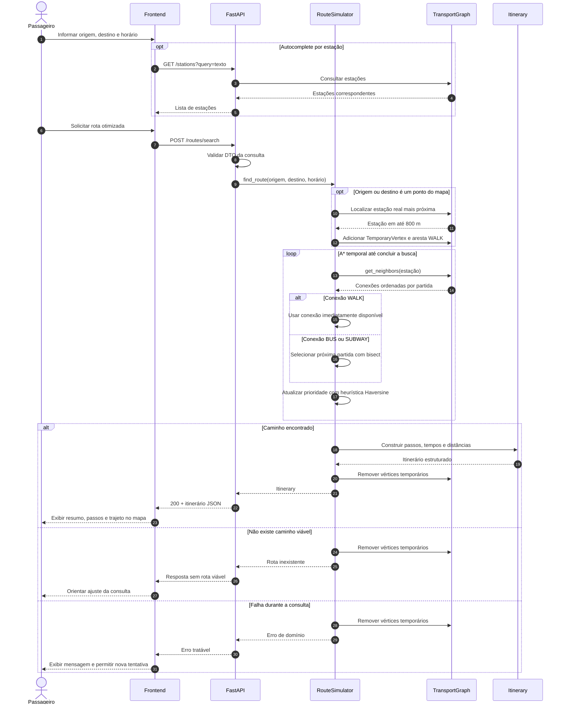

# Diagramas de Sequência - MVP RotasGraph

As sequências abaixo descrevem a arquitetura-alvo completa. A primeira prepara
o grafo em memória; a segunda executa a consulta principal do passageiro.

## 1. Inicialização e carga do grafo

## 2. Busca de rota otimizada

## Referência do padrão

- [Mermaid - Sequence diagrams](https://mermaid.js.org/syntax/sequenceDiagram)
