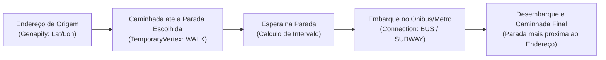
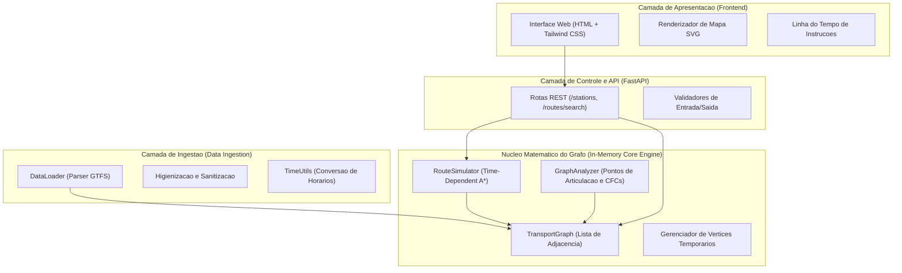
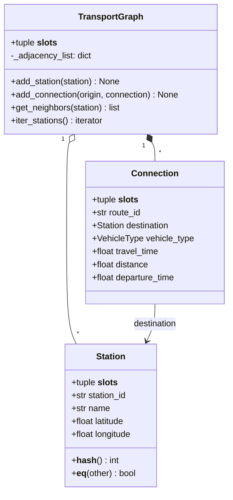
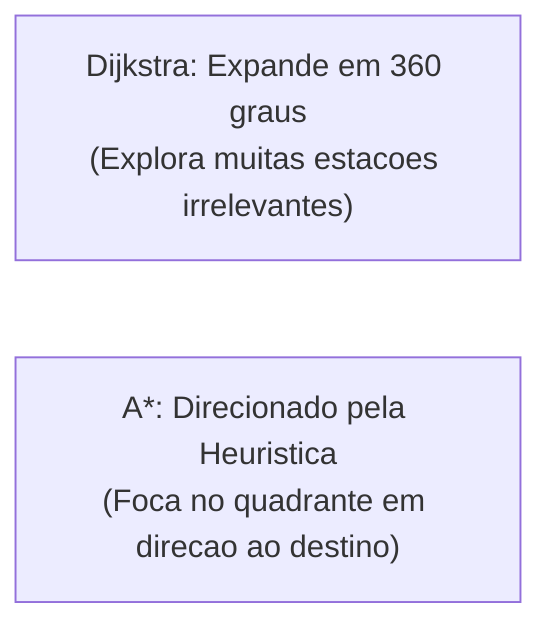
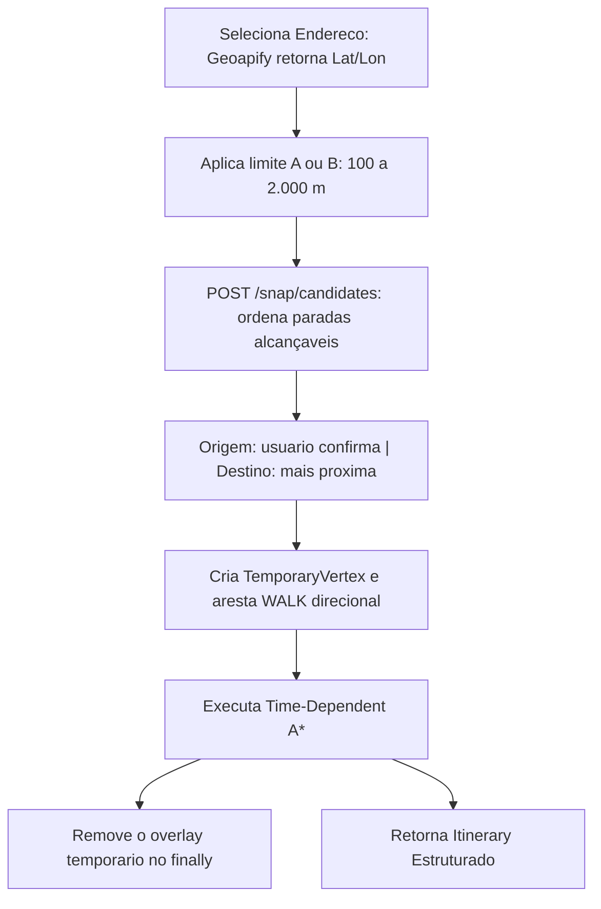
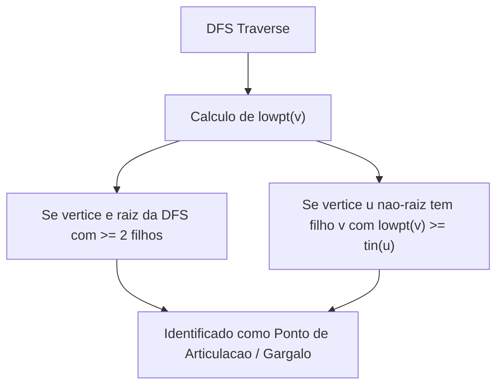

# Guia Tecnico Didatico: Otimizador de Rotas de Transporte Urbano

Este documento apresenta uma explicacao completa, aprofundada e didatica da engenharia e da teoria por tras do projeto **Otimizador de Rotas de Transporte Urbano**. O conteudo esta estruturado acompanhando as 10 partes do planejamento oficial ([PLAN.md](PLAN.md)), desmistificando os conceitos matematicos e computacionais para quem esta tendo o primeiro contato com o tema.

---

## Sumario Executivo da Arquitetura

O sistema resolve um problema comum a milhoes de cidadaos: encontrar a rota mais rapida entre dois pontos de uma metropole (neste MVP, Belo Horizonte) utilizando transporte publico (onibus, metro e caminhada).

Diferente de um GPS para automoveis (como o Waze ou Google Maps em modo carro), no transporte publico **as conexoes nao estao disponiveis a todo instante**. Uma rua de automovel esta sempre transitavel (salvo bloqueios), mas uma linha de onibus so pode ser utilizada quando um veiculo passa na parada. Por essa razao, o modelo matematico adotado e um **Grafo Dependente do Tempo** (*Time-Dependent Graph*).



---

## Parte 1: Planejamento, Arquitetura e Decisoes de Design

### 1. O Que e um Grafo Dependente do Tempo?
Em teoria dos grafos tradicional, um grafo e composto por:
- **Vertices (ou Nos)**: representam pontos, locais ou entidades.
- **Arestas**: representam as ligacoes entre esses pontos, normalmente com um peso fixo (como distancia em quilometros).

No mundo do transporte publico, isso nao e suficiente. Se uma viagem de onibus da Estacao Central ate a Praca da Savassi leva 15 minutos, o tempo de deslocamento do usuario nao e apenas 15 minutos: **depende de que horas o passageiro chegou a estacao**. Se o passageiro chegou as 08:02 e o proximo onibus sai as 08:20, havera 18 minutos de espera, totalizando 33 minutos.

Um **Grafo Dependente do Tempo** e aquele em que o custo de percorrer uma aresta e uma funcao do horario de chegada ao vertice de origem:

$$\text{Custo}(u, v, t) = \text{Espera}(u, t) + \text{TempoViagem}(u, v, t_{\text{partida}})$$

### 2. Isolamento Arquitetural (MVC / Clean Architecture)
Para garantir qualidade de software profissional e atender aos requisitos disciplinares rigorosos, o sistema foi desenhado em camadas desacopladas:



**Regra de Ouro**: O nucleo do grafo (`TransportGraph`, `RouteSimulator`, `GraphAnalyzer`) nao sabe o que e web, nao importa FastAPI, nao manipula HTML e nao depende de nenhuma biblioteca pronta de grafos (como NetworkX). Ele opera puramente com estruturas nativas do Python.

---

## Parte 2: Scaffolding, Infraestrutura e Metodologia TDD

### 1. O Que e Test-Driven Development (TDD)?
No desenvolvimento deste projeto, adotou-se estritamente o **TDD (Desenvolvimento Guiado por Testes)**, que segue o ciclo conhecido como **Red-Green-Refactor**:

1. **Red (Vermelho)**: Escreve-se primeiro um teste automatizado que expressa o comportamento esperado de uma funcao ou classe que ainda nao existe. O teste falha.
2. **Green (Verde)**: Escreve-se a menor quantidade possivel de codigo necessaria para fazer o teste passar.
3. **Refactor (Refatorar)**: Limpa-se e otimiza-se o codigo, garantindo que continue passando nos testes e respeitando as boas praticas.

### 2. Estrutura de Diretorios
O repositorio e organizado em diretorios bem delimitados:
- `backend/`: codigo-fonte do servidor, dividido em `app/` (dominio, regras e API) e `tests/` (testes automatizados com pytest).
- `frontend/`: arquivos da interface visual (HTML, CSS, JS).
- `data/`: arquivos de dados reais da cidade (`data/gtfs/`).
- `docs/`: documentacao analitica, plano de desenvolvimento ([PLAN.md](PLAN.md)), diretrizes tecnicas ([AGENTS.md](../AGENTS.md)) e fontes LaTeX.
- `Artefatos/`: diagramas arquiteturais e prototipos de interface.

---

## Parte 3: Ingestao de Dados e Higienizacao (GTFS)

### 1. O Que e o GTFS?
O **GTFS** (*General Transit Feed Specification*) e o padrao mundial adotado por agencias de transporte (incluindo a BHTRANS em Belo Horizonte) para disponibilizar dados de itinerarios e tabelas de horarios em arquivos de texto delimitados por virgula (CSV). O sistema utiliza quatro arquivos centrais:

| Arquivo GTFS | O Que Representa? | Analogia Didatica |
| :--- | :--- | :--- |
| `stops.txt` | Lista de paradas e estacoes fisicas, com coordenadas geocodificadas (latitude e longitude). | Os pontos de parada fixados nas calcadas e estacoes de metro. |
| `routes.txt` | As linhas de transporte existentes (ex.: Linha 50, Linha 82, Metro Linha 1). | O catalogo geral de linhas com seus numeros e nomes. |
| `trips.txt` | Cada viagem individual realizada ao longo do dia por uma linha especifica. | A viagem especifica do Onibus 50 que parte as 08:00 de segunda-feira. |
| `stop_times.txt` | Os horarios programados de chegada e partida de cada viagem em cada parada da sequencia. | O cronograma de paradas da viagem: 08:00 na Parada 1, 08:12 na Parada 2, etc. |

### 2. O Desafio de Escala e o Git LFS
Na base real de Belo Horizonte, o arquivo `stop_times.txt` possui mais de **450 megabytes** e milhoes de linhas. Como o GitHub impoe um limite maximo de 100 MB por arquivo em repositorios normais, utilizou-se o **Git LFS** (*Large File Storage*), que substitui arquivos pesados por ponteiros leves no controle de versao e faz o download seguro sob demanda.

### 3. Leitura em Streaming com `itertools.groupby`
Carregar centenas de megabytes de texto de uma so vez criaria um consumo exorbitante de memoria RAM. Por isso, a classe `DataLoader` foi projetada para processar o arquivo `stop_times.txt` em **streaming** (fluxo continuo). Usando `itertools.groupby`, o leitor agrupa as linhas viagem por viagem (`trip_id`), valida todos os pontos daquela viagem em memoria e, se estiver correta, descarrega as conexoes diretamente no grafo, liberando a memoria daquela viagem em seguida.

### 4. Higienizacao e Tratamento de Anomalias do Mundo Real
Dados publicos frequentemente possuem inconsistencias. O `DataLoader` atua como um filtro rigoroso:
- **Coordenadas invalidas**: Paradas com latitudes fora de $[-90, 90]$ ou longitudes fora de $[-180, 180]$ sao descartadas.
- **Viagens inconsistentes**: Se um onibus estiver programado para sair antes de chegar (`departure < arrival`) ou se o tempo de viagem for negativo, a viagem inteira e descartada de forma atomica.
- **Velocidades suspeitas**: Viagens que implicariam velocidades acima de 120 km/h dentro da malha urbana sao sinalizadas com alertas.
- **Tempo zero entre paradas distintas**: Dois pontos fisicos diferentes com horario identico sao postos em quarentena para nao distorcer a modelagem.

### 5. `TimeUtils`: Minutos Fracionarios e Horarios Acima de 24h
Em transporte publico, viagens que comecam antes da meia-noite e entram pela madrugada sao comumente descritas no GTFS com horarios como `24:15:00` ou `25:30:00` para manter a associacao com a jornada do dia de servico anterior. A classe `TimeUtils` aceita essas notacoes e converte todos os horarios para **minutos fracionarios** desde o inicio do dia de servico:

$$\text{minutos} = \frac{\text{horas} \times 3600 + \text{minutos} \times 60 + \text{segundos}}{60}$$

---

## Parte 4: Estrutura do Grafo em Memoria e Gerenciamento de RAM

### 1. Entidades de Dominio
As entidades basicas do sistema foram modeladas com precisao:
- `Station`: Representa o vertice (identificador unico, nome, latitude e longitude). A igualdade e a funcao hash dependem apenas do `station_id`, tornando-a ideal como chave de dicionarios.
- `Connection`: Representa a aresta direcionada (estacao de destino, linha/rota, modal de transporte, tempo de deslocamento, distancia em km e horario exato de partida).
- `VehicleType`: Enum com os tipos suportados (`BUS`, `SUBWAY`, `WALK`).
- `TransportGraph`: Estrutura principal da rede viaria em memoria.

### 2. A Escolha da Lista de Adjacencia em Dicionario
A representacao escolhida para o grafo foi um dicionario nativo do Python:

```python
dict[Station, list[Connection]]
```

Essa escolha oferece caracteristicas assintoticas ideais:
- Adicionar uma estacao: $O(1)$ amortizado.
- Consultar se uma estacao existe: $O(1)$ medio.
- Recuperar as conexoes que saem de uma estacao (`get_neighbors`): $O(1)$, pois acessa diretamente o valor mapeado pela chave.

### 3. A Otimizacao Crucial com `__slots__`
Em Python padrao, todo objeto instanciado possui um dicionario interno oculto chamado `__dict__`, responsavel por permitir que novos atributos sejam adicionados dinamicamente em tempo de execucao. O `__dict__` consome uma quantidade significativa de memoria RAM (cerca de 150 a 200 bytes por objeto).

Multiplicando essa sobrecarga por centenas de milhares de estacoes e conexoes, o sistema gastaria centenas de megabytes apenas com metadados do interpretador.

Ao declarar explicitamente `__slots__` (ou `@dataclass(slots=True)`):
- O Python elimina o `__dict__` individual de cada instancia.
- A alocacao de atributos torna-se estatica em memoria, semelhante a uma struct da linguagem C.
- Reduz o consumo de memoria em mais de **60%**, acelerando o acesso aos campos e mantendo o processamento inteiramente na RAM do computador.



---

## Parte 5: Motor de Roteamento (Algoritmo A* Dependente do Tempo)

### 1. Por Que o A* em Vez do Dijkstra Tradicional?
O algoritmo de **Dijkstra** expande a busca de caminhos em todas as direcoes uniformemente, como uma onda circular que se espalha em uma piscina, explorando muitos caminhos que estao no sentido oposto ao destino.

O algoritmo **A\*** (A-Star) e uma evolucao do Dijkstra que introduz uma **funcao heuristica** $h(u)$, que da uma "dica" ou "estimativa de distancia" ate o destino final. Ele prioriza a exploracao dos nos que parecem estar se aproximando do objetivo:

$$f(u) = g(u) + h(u)$$

Onde:
- $g(u)$: custo real ja percorrido da origem ate o no $u$ (em minutos).
- $h(u)$: custo estimado para ir de $u$ ate o destino final (em minutos).
- $f(u)$: custo total estimado do caminho passando por $u$.



### 2. Distancia Geodesica: Formula de Haversine
A Terra nao e plana; logo, o Teorema de Pitagoras tradicional nao calcula com precisao a distancia entre duas coordenadas geograficas. Utiliza-se a **Formula de Haversine**, que calcula a distancia do grande circulo sobre a superficie de uma esfera de raio $R = 6.371\text{ km}$:

$$\Delta\phi = \phi_2 - \phi_1, \quad \Delta\lambda = \lambda_2 - \lambda_1$$

$$a = \sin^2\left(\frac{\Delta\phi}{2}\right) + \cos(\phi_1)\cos(\phi_2)\sin^2\left(\frac{\Delta\lambda}{2}\right)$$

$$d = 2 \cdot R \cdot \arcsin(\sqrt{a})$$

### 3. A Heuristica Admissivel e Consistente
Para que o algoritmo A* garanta matematicamente que encontrara o **caminho otimo** (o mais rapido possivel), a heuristica precisa ser **admissivel**. Isso significa que ela **nunca pode superestimar o custo real restante**.

Como nosso custo e medido em **minutos de viagem**, formulamos:

$$h(u, v) = \frac{\text{haversine}(u, v)}{V_{\max}}$$

Onde $V_{\max}$ e a velocidade maxima teorica possivel em toda a rede de transporte (expressa em quilometros por minuto). Como nenhum onibus ou metro pode viajar mais rapido que $V_{\max}$ e a linha reta e a menor distancia entre dois pontos, o tempo real de deslocamento sera **sempre maior ou igual** a $h(u, v)$. Isso comprova a admissibilidade da heuristica.

### 4. Consulta Temporal em $O(\log K)$ com Busca Binaria (`bisect`)
Quando o algoritmo A* chega a uma estacao no horario corrente $t_{\text{atual}}$, ele precisa saber: *qual e a proxima viagem disponivel saindo daqui?*

Se a estacao tiver centenas de partidas ao longo do dia, percorrer uma lista do inicio ao fim para achar o primeiro horario posterior a $t_{\text{atual}}$ levaria tempo linear $O(K)$.

**A solucao de engenharia**:
1. Durante a ingestao, as conexoes de cada estacao sao mantidas **estritamente ordenadas** por horario de partida (`departure_time`).
2. O algoritmo utiliza a funcao nativa `bisect_right` da biblioteca `bisect` do Python para encontrar o proximo onibus em **tempo logaritmico $O(\log K)$**.

$$\text{Tempo de Espera} = \text{departure\_time} - t_{\text{atual}}$$

---

## Parte 6: Vertices Temporarios e Resposta Estruturada

### 1. Vertices Temporarios e o Mecanismo *Snap-to-Network*
O usuario seleciona enderecos de Belo Horizonte no autocomplete. O Geoapify/OpenStreetMap fornece apenas o rotulo e as coordenadas; o RotasGraph escolhe as paradas e calcula a rota localmente.

Para resolver isso sem alterar a base oficial de dados, o sistema utiliza a especializacao `TemporaryVertex`:
1. O usuario escolhe limites independentes entre 100 e 2.000 metros para origem e destino; ambos comecam em 800 metros.
2. `POST /snap/candidates` calcula Haversine ate estacoes reais, filtra pelo limite e ordena por distancia e ID.
3. Na origem, a estacao mais proxima e recomendada, mas outra candidata valida pode ser confirmada. No destino, a mais proxima e automatica.
4. Na consulta, o motor cria um vertice temporario para cada endereco e uma aresta direcional `WALK`: ponto--parada na origem e parada--ponto no destino.
5. As caminhadas usam aproximadamente $5\text{ km/h}$ ($\approx 0{,}083\text{ km/min}$) e partem imediatamente.
6. O A* calcula a rota entre os dois vertices temporarios.
7. As arestas ficam em um overlay privado e sao removidas no `finally`; o `TransportGraph` compartilhado nunca e mutado.



### 2. A Classe `Itinerary`
O resultado da busca e consolidado no objeto de dominio `Itinerary`, que contem:
- Tempo total da viagem (em minutos).
- Tempo total gasto em deslocamento vs. tempo gasto esperando em paradas.
- Distancia total percorrida (em km).
- Lista discriminada de instrucoes passo a passo (ex.: "Caminhe 300m ate a Parada X", "Embarque na Linha 50 as 08:15", "Desembarque na Estacao Central as 08:35").
- Metodos de conversao nativa para dicionario e JSON para envio imediato pela API.

---

## Parte 7 e 8: Interface Grafica, API e Integracao

### 1. Camada Controladora (FastAPI)
O backend expoe endpoints simples e eficientes:
- `GET /stations`: Lista as estacoes existentes para pesquisa e autocompletar na interface.
- `POST /routes/search`: Recebe a coordenada/estacao de origem, coordenada/estacao de destino e o horario desejado de saida, aciona o `RouteSimulator` e retorna o JSON do `Itinerary`.
- `GET /health`: Endpoint leve para checagem de integridade e prontidao do servico.

### 2. Interface Grafica (HTML5, Tailwind CSS e Vanilla JavaScript)
O frontend foi desenvolvido com foco em desempenho, leveza e aderencia as diretrizes visuais do projeto:
- **Sem frameworks pesados**: Uso de Vanilla JavaScript para manipular eventos do mapa e requisicoes HTTP via `fetch`.
- **Renderizacao vetorial em SVG**: A malha da cidade e o traçado da rota sao desenhados com elementos SVG interativos.
- **Identidade cromatica do projeto**:
  - Azul Primario (`#209dd7`): Linhas e conexoes de Metro/Trem.
  - Vermelho Transito (`#e11d48`): Linhas e conexoes de Onibus.
  - Roxo Secundario (`#753991`): Botoes de acao e pesquisa.
  - Marinho Escuro (`#032147`): Cabecalhos e barras principais.
  - Amarelo Destaque (`#ecad0a`): Marcadores de pontos temporarios e selecoes do usuario.
  - Cinza Texto (`#888888`): Indicacoes de trechos a pe (caminhada).

---

## Parte 9: Analise de Topologia, Vulnerabilidade e Desempenho

Alem de calcular o trajeto mais rapido, o projeto inclui um modulo analitico avancado: a classe `GraphAnalyzer`. Seu papel e examinar a resiliencia e a estrutura matematica da malha de transporte da cidade.

### 1. Pontos de Articulacao (Gargalos Criticos da Cidade)
Em teoria dos grafos, um **Ponto de Articulacao** (ou vertice de corte) e um vertice cuja remocao desconecta o grafo ou aumenta o numero de componentes conexos.

No contexto de transporte publico:
> Se uma estacao for um Ponto de Articulacao e precisar ser fechada por obras ou incidentes, partes inteiras da cidade ficarao isoladas entre si pelo transporte publico!

O `GraphAnalyzer` identifica esses pontos utilizando uma **Busca em Profundidade (DFS)** combinada com o calculo dos tempos de descoberta (`tin`) e os valores de menor ponto de retorno (`lowpt`):



### 2. Componentes Fortemente Conexos (CFCs)
Como as rotas de onibus sao direcionadas (arestas direcionadas), nem sempre e possivel voltar por onde se veio. Um **Componente Fortemente Conexo (CFC)** e um subconjunto de estacoes no qual, a partir de qualquer estacao $u$, e possivel alcancar qualquer estacao $v$ respeitando as direcoes das viagens.

O `GraphAnalyzer` calcula os CFCs utilizando o **Algoritmo de Tarjan** ou o **Algoritmo de Kosaraju**, ambos com complexidade linear $O(V + E)$, permitindo auditar regioes da cidade que possuem cobertura bidirecional completa versus regioes que sofrem com isolamento direcional.

### 3. Tabela de Complexidade Assintotica (Big-O)

| Operacao / Algoritmo | Complexidade Temporal | Complexidade Espacial | Justificativa |
| :--- | :--- | :--- | :--- |
| Adicionar Vertice (`add_station`) | $O(1)$ amortizado | $O(1)$ | Insercao em tabela hash de dicionario nativo. |
| Adicionar Conexao (`add_connection`) | $O(\log K + K)$ | $O(1)$ | Busca binaria com `bisect_right` ($O(\log K)$) seguida da insercao na lista nativa. |
| Obter Vizinhos (`get_neighbors`) | $O(1)$ | $O(1)$ | Consulta direta por chave no dicionario de adjacencia. |
| Consulta Temporal de Partida | $O(\log K)$ | $O(1)$ | Busca binaria sobre a lista ordenada de conexoes. |
| Heuristica de Haversine | $O(1)$ | $O(1)$ | Operacoes trigonometricas de tempo constante. |
| Roteamento A* | $O((V + E) \log V)$ | $O(V)$ | Fila de prioridade em heap binario (`heapq`). |
| Pontos de Articulacao (DFS + lowpt) | $O(V + E)$ | $O(V)$ | Varredura em profundidade com vetores auxiliares. |
| Componentes Fortemente Conexos (Tarjan) | $O(V + E)$ | $O(V)$ | DFS com pilha de recursao linear. |

*Nota: $V$ representa a quantidade de estacoes, $E$ o total de conexoes e $K$ o numero de viagens saindo de uma unica estacao.*

---

## Parte 10: Relatorio Cientifico e Apresentacao

Para concluir o ciclo academico rigoroso exigido pela PUC Minas, os resultados sao sintetizados nos artefatos finais:
1. **Relatorio em LaTeX (Formato SBC)**:
   - Artigo com 12 a 15 paginas estruturado de acordo com as normas da Sociedade Brasileira de Computacao.
   - Formalizacao matematica do grafo dependente do tempo, prova de admissibilidade da heuristica de Haversine e analise formal de corretude do A*.
   - Relatorio empirico comparando consumo de memoria com e sem `__slots__` e comparando o tempo de execucao do motor proprio contra o Dijkstra/A* da biblioteca NetworkX (usada exclusivamente para fins comparativos).
2. **Defesa Oral e Demonstracao Visual**:
   - Apresentacao oral presencial de 10 minutos com slides estruturados.
   - Video demonstrativo de 12 a 18 minutos com a participacao individual de todos os integrantes da equipe, exibindo o sistema operando de ponta a ponta sobre dados reais da BHTRANS.

---

## Glossario Didatico para Iniciantes

- **Admissibilidade**: Propriedade de uma funcao heuristica que promete nunca "chutar" uma distancia maior do que a distancia real. Se a heuristica for admissivel, o A* tem garantia matematica de encontrar o caminho mais rapido.
- **Big-O ($O$)**: Notacao matematica usada em ciencia da computacao para descrever como o tempo de execucao ou o consumo de memoria de um programa cresce a medida que a quantidade de dados aumenta.
- **DFS (*Depth-First Search*)**: Algoritmo de Busca em Profundidade que explora uma ramificacao do grafo o maximo possivel antes de retroceder.
- **Fila de Prioridade (`heapq`)**: Uma estrutura de dados que sempre mantem o elemento de menor custo no topo, permitindo retira-lo em tempo quase instantaneo ($O(\log N)$).
- **Lista de Adjacencia**: Uma maneira eficiente de guardar grafos no computador, onde cada no possui uma lista das suas arestas que saem para outros nos.
- **Ponto de Articulacao**: Vertice critico cuja destruicao ou interrupcao parte o grafo em pedacos desconectados.
- **Slots (`__slots__`)**: Recurso especial da linguagem Python que proibe atributos dinamicos em objetos para economizar espaco de memoria RAM.
