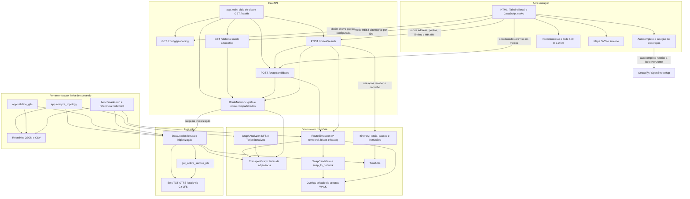

# Diagrama de Componentes - MVP RotasGraph

Componentes disponíveis e dependências.

O domínio não importa FastAPI, frontend ou NetworkX. A API reutiliza um grafo
por data de serviço; o roteador retorna um caminho e a API cria `Itinerary`.
O frontend geocodifica os endereços, pré-visualiza candidatas por
`POST /snap/candidates` e envia a rota por endereço. A API repete a validação,
aplica limites independentes de 100 a 2.000 metros e cria duas caminhadas
direcionais em um overlay descartável. O grafo compartilhado não é mutado.

A [CLI topológica](../../../docs/GRAPH_ANALYZER.md) usa `GraphAnalyzer` sem
endpoint analítico. Articulações usam projeção não direcionada simples; CFCs
usam Tarjan iterativo. A análise ignora horários e vértices temporários.
NetworkX fica somente no benchmark.

Recuperar vizinhos custa `O(1)` médio; inserir uma conexão ordenada custa
`O(K)` no pior caso. O `bisect` localiza a primeira partida em `O(log K)`,
seguido da varredura do sufixo relevante. O grafo permanece na RAM.
