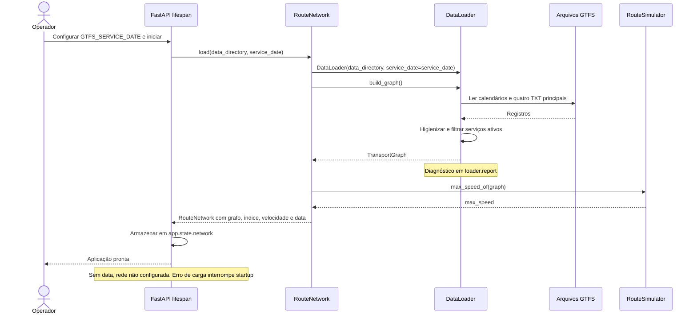
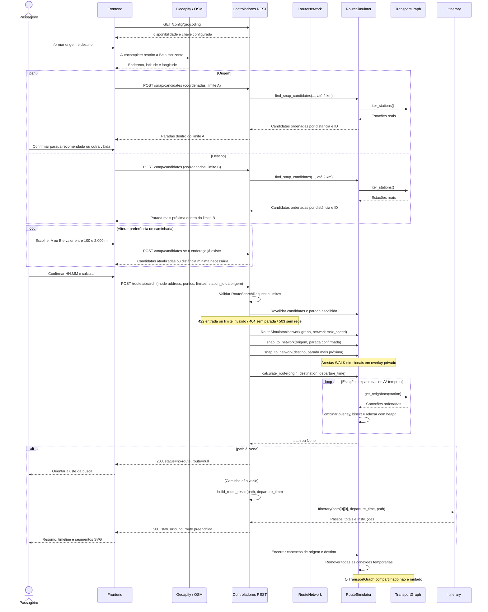

# Diagramas de Sequência - MVP RotasGraph

## 1. Inicialização para uma data de serviço

## 2. Busca por endereços com snap-to-network

Os limites A e B são independentes, começam em 800 metros e aceitam qualquer
inteiro entre 100 e 2.000. Eles podem ser salvos antes dos endereços. A API
repete todas as validações do frontend; a origem deve indicar uma candidata
válida e o destino usa a mais próxima.

O modo `station`, com `origin_id` e `destination_id`, permanece disponível no
mesmo endpoint para clientes REST. A interface usa `mode: "address"`. Editar
endereços, limites ou horário cancela a consulta e descarta respostas antigas.

A CLI `app.analyze_topology` chama `DataLoader.build_graph` e `GraphAnalyzer`
e exporta JSON separadamente, sem endpoint analítico. Veja
[a API](../../../docs/API.md) e [a CLI](../../../docs/GRAPH_ANALYZER.md).

## Referência do padrão

- [Mermaid - Sequence diagrams](https://mermaid.js.org/syntax/sequenceDiagram)
